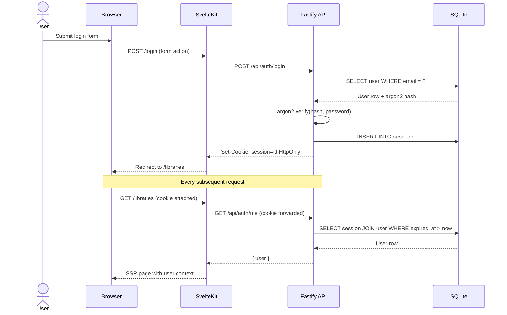
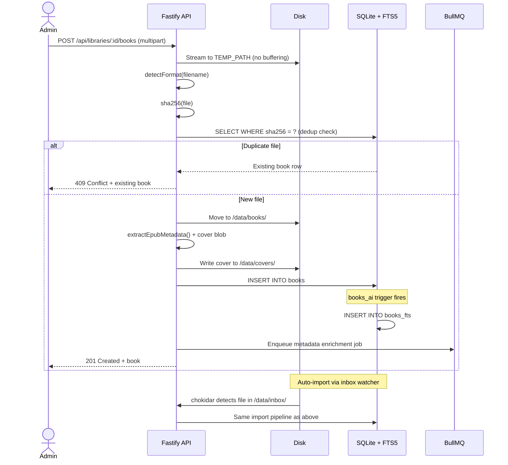

# Digital Library

- [Project Overview](#project-overview)
- [Technology Stack](#technology-stack)
- [Architecture](#architecture)
- [One-Command Deploy](#one-command-deploy)
- [Development](#development)
- [Required Secrets (GitHub Actions)](#required-secrets-github-actions)
- [Build Phases](#build-phases)

## Project Overview

Self-hosted, privacy-first digital library that handles EPUB, PDF, CBZ/CBR comics, and loose image files. It is designed to run entirely from a Docker Compose stack with no external cloud services and no recurring costs.

### Core features

- Full-text search with FTS5 MB25 ranking (porter stemmer, prefix matching) across title and author, with 350ms debounced input and per-term highlighting.
- Filter by format, author, series, language, and tags with URL-driven state (bookmarkable, back-button-safe).
- GSAP page transitions and card animations.
- User auth with per-library ACL.
- Native EPUB / PDF / Comic readers.
- Rich metadata + auto-fetch.
- Send to Kindle via SMTP.
- Auto-import file watcher.
- Desktop first.

## Technology Stack

| Technology                       | Why?                                                                                                                                                                                                                                                                                                                        |
| -------------------------------- | --------------------------------------------------------------------------------------------------------------------------------------------------------------------------------------------------------------------------------------------------------------------------------------------------------------------------- |
| **Fastify + TypeScript**         | 2x faster than Express, first-class TypeScript, great plugin ecosystem.                                                                                                                                                                                                                                                     |
| **SvelteKit**                    | Tiny bundles (than Next.js), which matters for a reading app that may run on a Raspberry Pi or low-end VPS, file-based routing, SSR out of the box, no virtual DOM overhead. Also, Svelte's reactivity model is a better fit for reader UI state (page position, zoom, layout mode) with less boilerplate than React hooks. |
| **SQLite (better-sqlite3)**      | Zero infra, file-based, ACID, blazing read speed for single-node self-hosted apps.                                                                                                                                                                                                                                          |
| **SQLite FTS5**                  | Built into SQLite, no Elasticsearch overhead, supports prefix & phrase queries.                                                                                                                                                                                                                                             |
| **epub.js (client-side)**        | De facto standard, supports CFI positions, reflow, custom CSS injection.                                                                                                                                                                                                                                                    |
| **PDF.js (client-side)**         | Mozilla's library, works fully offline, no server-side processing required.                                                                                                                                                                                                                                                 |
| **Open Library API + ComicVine** | Both free, Open Library requires no API key at all.                                                                                                                                                                                                                                                                         |
| **chokidar**                     | Battle-tested, cross-platform, handles rapid write bursts gracefully.                                                                                                                                                                                                                                                       |
| **Calibre CLI (headless)**       | Industry standard, free, packaged in Docker for EPUB to MOBI/AZW3 conversion.                                                                                                                                                                                                                                               |
| **BullMQ + Redis**               | Async metadata fetch and Kindle send jobs. Redis Alpine is only 30MB.                                                                                                                                                                                                                                                       |
| **nodemailer + SMTP**            | Free with Gmail App Password or any SMTP provider.                                                                                                                                                                                                                                                                          |
| **Docker + Compose**             | One-command deploy, fully portable, no cloud lock-in.                                                                                                                                                                                                                                                                       |
| **Caddy**                        | Auto HTTPS via Let's Encrypt, trivial config, single static binary.                                                                                                                                                                                                                                                         |
| **Vitest**                       | SvelteKit already uses internally, zero extra tooling, single test command.                                                                                                                                                                                                                                                 |

## Architecture

### Repository Structure

```txt
digital-library/
  ├── apps/
  │ ├── api/                  # Fastify backend
  │ │ └── src/
  │ │ ├── routes/             # books, auth, libraries, kindle
  │ │ ├── services/           # metadata, importer, smtp
  │ │ ├── db/                 # schema, migrations, queries
  │ │ └── jobs/               # BullMQ workers
  │ └── web/                  # SvelteKit frontend
  │ └── src/
  │ ├── routes/               # SvelteKit page files
  │ ├── lib/readers/          # EpubReader, PdfReader, ComicReader
  │ └── lib/stores/           # reading position, user settings
  ├── packages/
  │ └── shared/               # shared TypeScript types (pnpm workspace)
  ├── data/                   # mounted Docker volume
  │ ├── books/                # all uploaded files
  │ ├── covers/               # generated thumbnails
  │ └── library.db            # SQLite database
  └── docker-compose.yml
```

### Design Patterns

| Pattern                        | Where & Why?                                                                                                                                                                         |
| ------------------------------ | ------------------------------------------------------------------------------------------------------------------------------------------------------------------------------------ |
| **Repository Pattern**         | All DB access goes through typed repository classes (e.g. BookRepository, UserRepository). This keeps raw SQL out of route handlers and makes testing and future storage swaps easy. |
| **Plugin Architecture**        | Each domain (books, auth, libraries, kindle) is a separate Fastify plugin registered with fastify.register(). Clean separation, lazy loading, and scoped decorators.                 |
| **Command / Job Queue**        | Async work like metadata fetch, Kindle send, and thumbnail generation is dispatched as BullMQ jobs rather than blocking the HTTP request. The API returns 202 Accepted immediately.  |
| **Adapter Pattern (Metadata)** | A MetadataAdapter interface with concrete implementations for OpenLibrary, ComicVine, and a FallbackAdapter. Adding a new metadata source does not touch business logic.             |
| **Reader Strategy Pattern**    | A single `<Reader>` Svelte component dispatches to `<EpubReader>`, `<PdfReader>`, or `<ComicReader>` based on `book.format`. Each reader owns its own layout modes and settings.     |
| **FTS5 Shadow Table**          | A virtual FTS5 table mirrors the books table. An SQLite trigger keeps it in sync on insert/update. Searches hit FTS5 for ranking then JOIN back to the main table for metadata.      |

### Auth & Session Flow



### Book Import Pipeline



---

## One-Command Deploy

```bash
git clone https://github.com/LuigiEspinosa/digital-library
cd digital-library
cp .env.example .env
# edit .env
docker compose up -d
```

## Development

```bash
# Prerequisites: Node 22.x (see .nvmrc), pnpm 10
# If you use fnm or nvm, cd into the repo and run
fnm use             # or: nvm use
corepack enable
pnpm install

# Run API + web in parallel
pnpm dev

# Tests
pnpm test

# Type check
pnpm typecheck
```

## Deploying to library.cuatro.dev

No workflow deploys this repository. `library.cuatro.dev` runs on the Cuatro estate's box from the checkout at
`/home/deploy/digital-library`, which tracks `main`, and is redeployed by hand after a merge to `main`. The
`Test & Deploy` workflow's `deploy` job, which SSHed into a VPS and had failed on every push to `main` since
2026-05-29, was removed by the Operator's ruling of 2026-10-12; the `Test` workflow and `CI` still run the suite.

This is the standing redeploy. On the box as `deploy`, from a file under `set -euo pipefail` (never piped
into `ssh` over stdin), in `/home/deploy/digital-library`:

```bash
git fetch origin
git reset --hard origin/main
git log -1 --format='%H %s'
docker compose up -d --build
docker compose ps
```

`~/library-redeploy.sh` on the box is recorded as running the fetch, the reset and the build (Anchor DW-185,
DW-187), then a smoke step. Then check that `api` and `web` report `healthy` in
`docker compose ps`, and from outside the box that `https://library.cuatro.dev/` answers 302, `/login` 200 and
`/api/health` 200 (the readings of the 2026-10-06 redeploy). That smoke step exits 60 on the
box's Origin CA certificate while the deploy is good (Anchor DW-338).

- Never run `git clean` in that checkout: the untracked `docker-compose.override.yml` there puts `api` and
  `web` on the network the estate's Traefik reaches them on, and removing it takes the site off the air
  (Anchor DW-187).
- The images build on the box (Anchor DW-185), so a redeploy costs the box a build.
- To roll back, `git reset --hard <previous main commit>` and `docker compose up -d --build` again.
- A change to these steps is made here and in the box's script together.

## Build Phases

| #   | Phase                                        | Status         |
| --- | -------------------------------------------- | -------------- |
| 1   | Monorepo scaffold + Docker Compose           | ✅ Done        |
| 2   | Auth system (auth, sessions, ACL)            | ✅ Done        |
| 3   | Library management CRUD                      | ✅ Done        |
| 4   | File import, deduplication, metadata extract | ✅ Done        |
| 5   | Library browse UI                            | ✅ Done        |
| 6   | Full-text search (FTS5)                      | ✅ Done        |
| 7   | EPUB reader                                  | ✅ Done        |
| 8   | PDF reader                                   | ✅ Done        |
| 9   | Comic/image reader                           | 🚧 In progress |
| 10  | Metadata enrichment (OpenLibrary, ComicVine) | 🔜             |
| 11  | Kindle send                                  | 🔜             |
| 12  | Polish & release                             | 🔜             |
